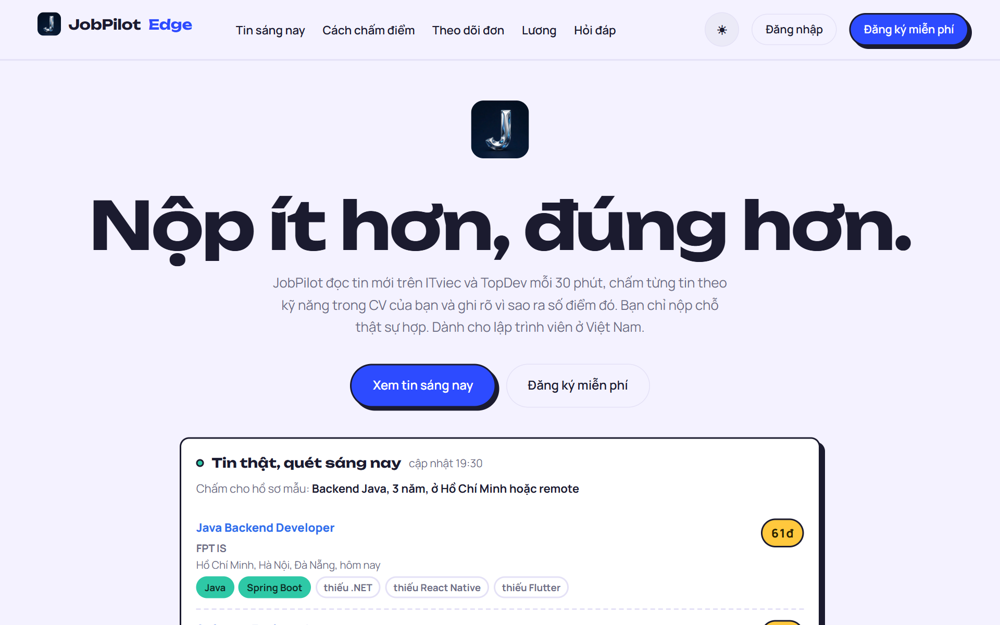
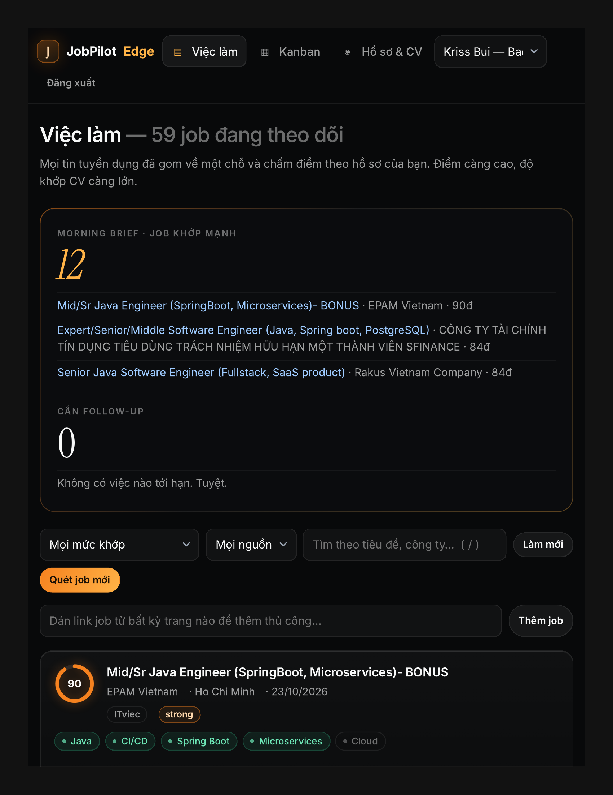
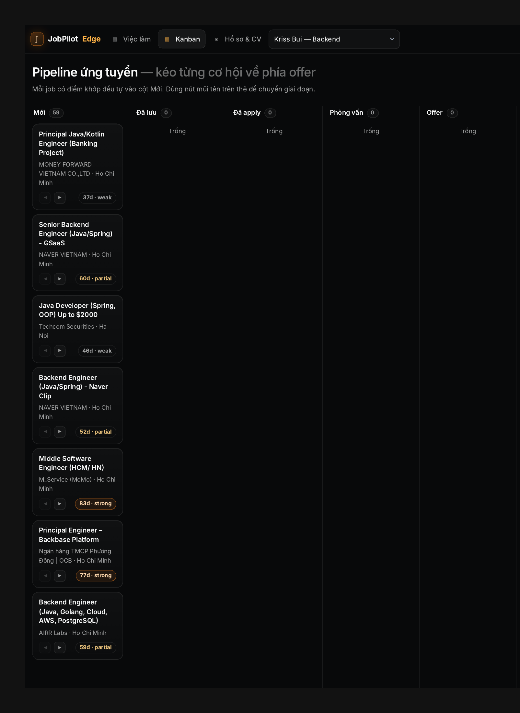
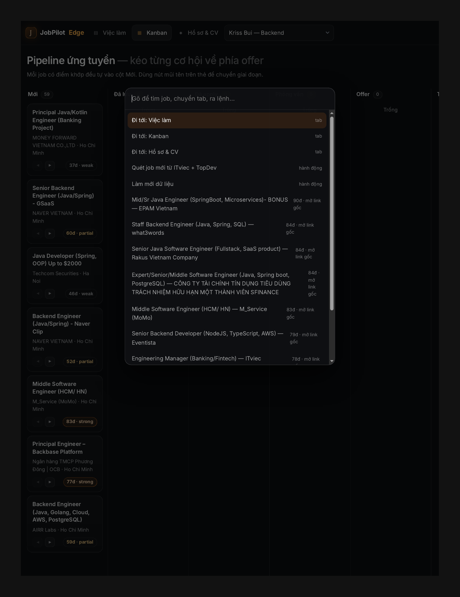
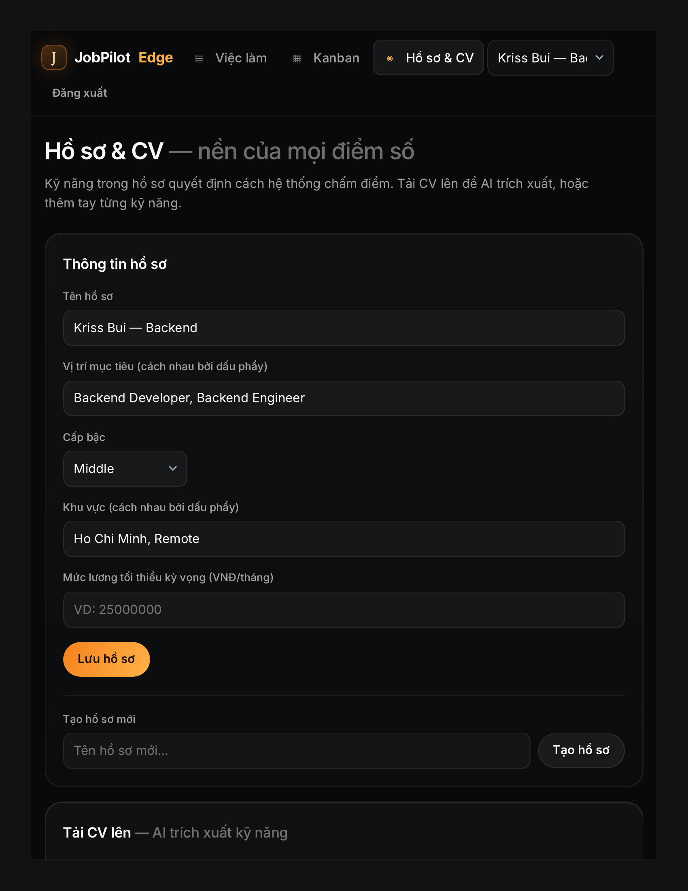
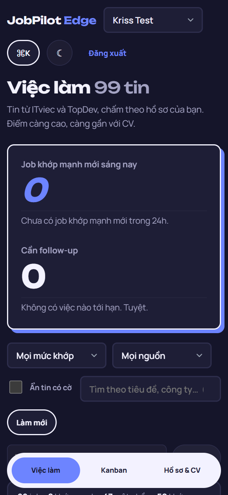
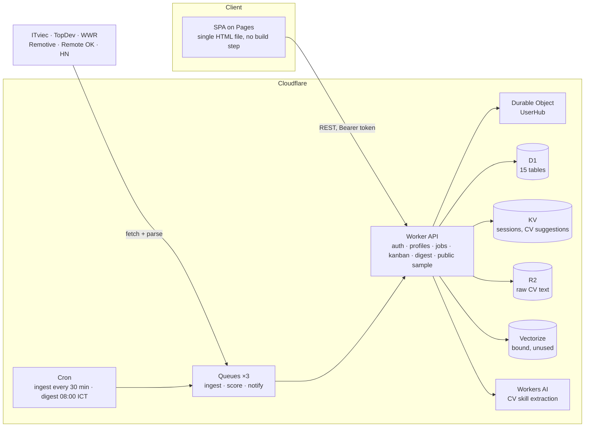

<div align="center">

# JobPilot Edge

**A job-hunting copilot for Vietnamese developers, running entirely on Cloudflare's edge.**

*Nộp ít hơn, đúng hơn.* Collects postings from six job sources every 30 minutes, scores each one against the skills in your CV, explains the score, and tracks your applications on a kanban board. Vietnamese and English.

**English** · [Tiếng Việt](README.vi.md)

[](https://jobpilot-edge.pages.dev)
[](https://jobpilot-api.tribui-it-work.workers.dev/api/health)
[](LICENSE)
[](https://developers.cloudflare.com/workers/)



</div>

## What it does

1. **Collects** new postings every 30 minutes from ITviec and TopDev (Vietnam) and from four public remote boards: We Work Remotely, Remotive, Remote OK and the monthly Hacker News "Who is hiring?" thread. Duplicates are dropped by content hash and a title gate removes non-engineering roles.
2. **Scores** every posting against each of your profiles: matched skill weight over the job's required weight, plus location, freshness and level fit. The breakdown is shown on every card, so a score is never a black box.
3. **Tracks** applications through seven stages (New, Saved, Applied, Interview, Offer, Rejected, Archived) with follow-up dates, silence alerts and an event history.
4. **Briefs** you each morning at 08:00 ICT with new strong matches and follow-ups that are due.

The landing page is not a mock-up: it calls `GET /api/public/sample` and renders the five best ITviec/TopDev matches for a sample backend profile from the live job table, with the current scan time.

## MVP status

The MVP is live and used daily. As of 3 Nov 2026 production holds 330 postings from six sources, 9 accounts and 10 profiles, with every source reporting `ok`.

| | Scope |
|---|---|
| **Shipped** | Email and password accounts, multiple profiles, CV upload with skill suggestions, draft profile filled from a CV, six job sources, explainable scoring with caps, job flags, seven-stage kanban with follow-ups and silence alerts, morning brief in the app, salary benchmark, command palette, light and dark themes, Vietnamese and English UI |
| **Backend only** | Durable Object realtime hub and `/api/notifications` exist but the web app does not use them yet. Vectorize is bound but nothing writes embeddings. The morning brief is built every day but only shown in the app; email delivery needs a custom domain |
| **Known gaps** | Manual job submission fetches any URL and shows the job to every user (fix ready on branch `task/T-05`, not merged). Scoring has no job description text yet, only the skill tags each board exposes, so many remote postings stop at 69. The salary benchmark falls back to a reference table because few postings state a salary. The morning brief is only visible in the app. Turnstile runs with Cloudflare test keys until a real widget is configured |
| **Not started** | AI explanations and interview prep, semantic matching, AI Gateway, Browser Rendering fallback for JS-only job pages, email routing, Turnstile, public profile pages, D1 backups, password reset |

The full plan, with phases and acceptance criteria, is in [`PLAN.md`](PLAN.md) (Vietnamese).

## Features

| Area | Details |
|---|---|
| Profiles | Several searches per account (for example "Backend Java" and "Backend Node"), each with its own weighted skills, target roles, level, locations and minimum salary. A profile can be cloned with its skills. |
| CV to profile | Upload a PDF, TXT or MD. Text is extracted in the browser (PDF.js). Workers AI and a curated skill catalogue propose weighted skills you confirm with a 1 to 5 weight bar. A separate "create profile from CV" card pre-fills name, roles, level and locations as a draft that is only saved when you press Save. |
| Job sources | ITviec and TopDev are fetched per keyword (Java, Node.js, Backend, Spring Boot). We Work Remotely (five RSS feeds), Remotive, Remote OK and HN Who's Hiring are fetched once per run, with no API keys. The jobs tab filters by source. |
| Scoring | Rule score out of 50 plus fit score out of 20, normalised to 100. Each job explains matched and missing skills with weights, plus location, freshness and level reasons. Any job can be rescored with another of your profiles. |
| Guards | Jobs listing fewer than 3 skills cap at 69. Jobs at a different level or outside your locations cap at 74, so they never show as "strong". |
| Job flags | Stale (over 30 days), duplicate (same company and title) and bloated JD (over 12 skills) chips, with a filter to hide flagged jobs. |
| Kanban | Drag and drop on desktop, arrow buttons on mobile, follow-up and snooze actions, "Cần chú ý" panel for applications silent for 7 days or past their follow-up date. |
| Salary benchmark | Median and P25 to P75 from postings that state a salary; falls back to a labelled market-reference table until enough data exists. Includes four negotiation scripts. |
| Command palette | `Ctrl/Cmd + K` searches jobs, switches tabs and profiles, triggers a refresh. `1` `2` `3` switch tabs, `/` focuses search. |
| Accounts | Email and password (PBKDF2-SHA256, 100k iterations, per-user salt, WebCrypto). Five failed logins per account lock it for 10 minutes, counted atomically in D1. Sessions are 30-day Bearer tokens in KV. |
| Languages | Vietnamese by default, English via the EN/VI button or `?lang=en`. Strings returned by the API (score reasons, flags, benchmark note) follow the `Accept-Language` header. |
| Themes | Light and dark, one toggle on landing, auth and app. First visit follows the OS preference. |

## Screenshots

| Jobs with score breakdown | Kanban pipeline |
|---|---|
|  |  |

| Command palette | Profile and skills |
|---|---|
|  |  |

<details>
<summary>Mobile, dark theme</summary>
<p align="center"></p>
</details>

## Architecture



| Layer | Service | Role |
|---|---|---|
| Frontend | Pages | `apps/web/public/index.html`, deployed by direct upload |
| API | Workers | One dependency-free Worker: 19 HTTP routes, queue consumers, cron handlers, Durable Object class |
| Async | Queues | Ingest, scoring and notify pipelines with retries |
| Data | D1 | Users, profiles, skills, jobs, matches, applications, events, digests, login failures |
| Session and cache | KV | 30-day sessions, 24-hour CV skill suggestions |
| Files | R2 | Raw CV text |
| Semantic | Vectorize (768d) | Bound for future semantic matching, not written to yet |
| AI | Workers AI | Llama 3.1 8B assists CV skill extraction |
| Realtime | Durable Objects | Per-user hub for strong-match broadcasts (not yet used by the web app) |

### Scoring model

```
rule_score  = Σ weight(matched skills) / Σ weight(job skills) × 50
fit_score   = location (≤ 8) + freshness (≤ 7) + level (≤ 5)
final_score = (rule_score + fit_score) / 70 × 100

tiers   strong ≥ 75 · partial ≥ 50 · weak < 50
caps    < 3 listed skills → 69 · level mismatch or outside your locations → 74
```

Remote postings often list fewer than three catalogue skills, so many of them stop at 69 by design.

## Project structure

```
jobpilot-edge/
├── PLAN.md                        # Product and architecture plan (Vietnamese)
├── apps/
│   ├── api/
│   │   ├── src/worker.js          # Worker: API, fetchers, queues, cron, Durable Object
│   │   ├── test/
│   │   │   ├── score.selfcheck.cjs          # scoring invariants
│   │   │   └── remote-sources.selfcheck.cjs # WWR / Remotive / Remote OK / HN parsers, offline
│   │   └── wrangler.toml.example  # Bindings template
│   └── web/
│       ├── public/index.html      # The whole SPA (inline CSS and JS)
│       └── test/i18n.selfcheck.cjs
├── db/migrations/
│   ├── 0001_init.sql              # 14 tables
│   ├── 0002_auth_passwords.sql    # password columns
│   └── 0003_login_failures.sql    # login throttling counter
└── docs/
    ├── SIGNAL-UI.md               # Design tokens and components of the shipped UI
    ├── UI-V2-SPEC.md              # Earlier design study, kept as history
    └── screenshots/
```

## Running it yourself

Requirements: a Cloudflare account, Node 18+, `wrangler` 4 (`npx wrangler@4`).

```bash
# 1. Bindings
cp apps/api/wrangler.toml.example apps/api/wrangler.toml
#    create one KV namespace, one D1 database, one R2 bucket, three Queues
#    (ingest, score, notify) and one Vectorize index (768 dimensions, cosine),
#    then paste their IDs into wrangler.toml

# 2. Schema (run all three, in order)
cd apps/api
npx wrangler@4 d1 execute <db-name> --remote --file ../../db/migrations/0001_init.sql
npx wrangler@4 d1 execute <db-name> --remote --file ../../db/migrations/0002_auth_passwords.sql
npx wrangler@4 d1 execute <db-name> --remote --file ../../db/migrations/0003_login_failures.sql

# 3. Worker (cron triggers come from wrangler.toml)
npx wrangler@4 deploy

# 4. Frontend: point API_BASE near the top of index.html's script at your Worker, then
npx wrangler@4 pages deploy ../web/public --project-name <pages-project>
```

Job sources register themselves on the first cron run. Local development: `npx wrangler@4 dev --local --test-scheduled` inside `apps/api`, and any static server for `apps/web/public` with `API_BASE` rewritten to `http://127.0.0.1:8787`. Hit `/__scheduled?cron=*/30+*+*+*+*` to run an ingest on demand.

Deployment order for changes that touch the schema: migration, then Worker, then Pages.

### Quality checks

```bash
node apps/api/test/score.selfcheck.cjs apps/api/src/worker.js
node apps/api/test/remote-sources.selfcheck.cjs apps/api/src/worker.js
node apps/web/test/i18n.selfcheck.cjs apps/web/public/index.html
```

During the October releases the UI was also checked with a Playwright matrix (three tabs, five widths from 360 to 1424 px, light and dark) and [impeccable](https://github.com/pbakaus/impeccable) on the production landing page. Those scripts are not part of this repo.

## API overview

All routes are under `/api`. Authenticated routes take `Authorization: Bearer <token>`. Send `Accept-Language: en` for English strings.

| Route | Purpose |
|---|---|
| `GET /health` | Binding status |
| `GET /public/sample` | Top ITviec/TopDev matches for a sample profile, public, cached 5 minutes |
| `POST /auth/register`, `POST /auth/login` | Accounts and sessions |
| `GET /me` | Current user, includes `is_owner` |
| `GET` `POST /profiles`, `PATCH /profiles/:id`, `POST /profiles/:id/cv-text`, `POST /profiles/:id/skills/confirm` | Profiles and skills |
| `GET /jobs`, `GET /jobs/:id`, `POST /jobs/submit` | Scored jobs for a profile (filter by `source`), manual URL submission |
| `GET` `POST /applications`, `PATCH /applications/:id` | Kanban |
| `GET /digest/today`, `GET /benchmark`, `GET /notifications` | Brief, salary benchmark, alerts |
| `GET /realtime` | WebSocket to the user's Durable Object hub |
| `/admin/*` | Owner only: ingest run and status, quota |

## Status

- **Live:** running since October 2026 on Workers Free. Latest changes: English UI and API strings (30 Oct), four remote job sources (30 Oct), landing hero motion and CV draft clean-up (31 Oct).
- **Security:** the October 2026 fix removed the password-claim flow (`/api/auth/set-password` now returns 410), scoped profiles and applications to their owner, and limited admin routes to the owner account. Open items are listed under Known gaps above.
- **3 Nov 2026:** kanban cards are no longer auto-created (migration 0004 removed 1,386 of them), scan keywords follow real profiles, region-locked remote postings no longer count as a location match; logout revokes the session, CV upload is capped at 5 MB, sign-ups are rate-limited per IP, consent before CV upload, account deletion with a 7-day restore window, data export, daily D1 backup to R2, Turnstile (test keys).
- **Next:** merge the manual-submission fix, fetch job descriptions for partial-or-better matches, show repost and days-open history per posting, Telegram daily brief, dead-letter queue, password reset. See [`ROADMAP.md`](ROADMAP.md).

## License

[MIT](LICENSE) © 2026 Bui Duc Tri

---

<div align="center">
<sub>Built by <a href="https://krissbui.vercel.app">Kriss Bui</a> as the successor to Job Watcher. Vietnamese-first, edge-only, no servers to keep alive.</sub>
</div>
