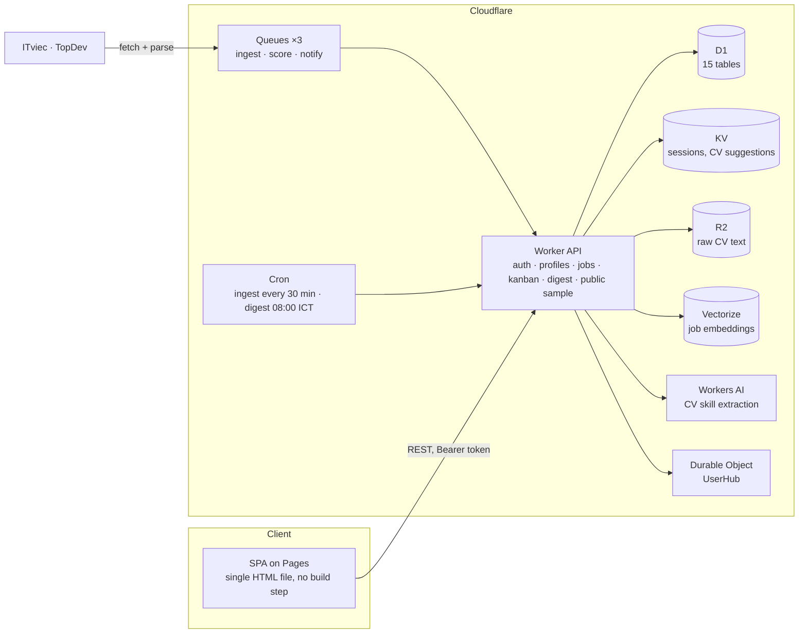

<div align="center">

# JobPilot Edge

**A job-hunting copilot for Vietnamese developers, running entirely on Cloudflare's edge.**

*Nộp ít hơn, đúng hơn.* Scans ITviec and TopDev every 30 minutes, scores each posting against the skills in your CV, explains the score, and tracks your applications on a kanban board.

**English** · [Tiếng Việt](README.vi.md)

[](https://jobpilot-edge.pages.dev)
[](https://jobpilot-api.tribui-it-work.workers.dev/api/health)
[](LICENSE)
[](https://developers.cloudflare.com/workers/)


</div>

## What it does

1. **Ingests** new postings from ITviec and TopDev on a cron (every 30 minutes), deduplicated by content hash, with a title gate that drops non-engineering roles.
2. **Scores** every posting against each of your profiles: matched skill weight over the job's required weight, plus location, freshness and level fit. The breakdown is shown on every card, so a score is never a black box.
3. **Tracks** applications through seven stages (New, Saved, Applied, Interview, Offer, Rejected, Archived) with follow-up dates, silence alerts and an event history.
4. **Briefs** you each morning at 08:00 ICT with new strong matches and follow-ups that are due.

The landing page is not a mock-up: it calls `GET /api/public/sample` and renders the five best matches for a sample backend profile from the live job table, with the current scan time.

## Features

| Area | Details |
|---|---|
| Profiles | Several searches per account (for example "Backend Java" and "Backend Node"), each with its own weighted skills, target roles, level, locations and minimum salary. |
| CV to skills | Upload a PDF, TXT or MD. Text is extracted in the browser (PDF.js), then Workers AI and a curated skill catalogue propose weighted skills you confirm with a 1 to 5 weight bar. |
| Scoring | Rule score out of 50 plus fit score out of 20, normalised to 100. Explainable per job: matched and missing skills with weights, location, freshness and level reasons. |
| Guards | Jobs listing fewer than 3 skills cap at 69. Jobs at a different level or outside your locations cap at 74, so they never show as "strong". |
| Job flags | Stale (over 30 days), duplicate (same company and title) and bloated JD (over 12 skills) chips, with a filter to hide flagged jobs. |
| Kanban | Drag and drop on desktop, arrow buttons on mobile, follow-up and snooze actions, "Cần chú ý" panel for applications silent for 7 days or past their follow-up date. |
| Salary benchmark | Median and P25 to P75 from postings that state a salary; falls back to a labelled market-reference table until enough data exists. Includes four negotiation scripts. |
| Command palette | `Ctrl/Cmd + K` searches jobs, switches tabs and profiles, triggers a refresh. `1` `2` `3` switch tabs, `/` focuses search. |
| Accounts | Email and password (PBKDF2-SHA256, 100k iterations, per-user salt, WebCrypto). Five failed logins per account are throttled with a D1-backed counter. Sessions are 30-day Bearer tokens in KV. |
| Themes | Light and dark, one toggle on landing, auth and app. First visit follows the OS preference. |
| Realtime | A Durable Object hub per user broadcasts strong-match events to connected clients. |

## Screenshots

| Jobs with score breakdown | Kanban pipeline |
|---|---|
|  |  |

| Command palette | Profile and skills |
|---|---|
|  |  |

<details>
<summary>Mobile, dark theme</summary>
<p align="center"></p>
</details>

## Architecture



| Layer | Service | Role |
|---|---|---|
| Frontend | Pages | `apps/web/public/index.html`, deployed by direct upload |
| API | Workers | One dependency-free Worker: HTTP routes, queue consumers, cron handlers, Durable Object class |
| Async | Queues | Ingest, scoring and notify pipelines with retries |
| Data | D1 | Users, profiles, skills, jobs, matches, applications, events, digests, login failures |
| Session and cache | KV | 30-day sessions, 24-hour CV skill suggestions |
| Files | R2 | Raw CV text |
| Semantic | Vectorize (768d) | Job embeddings, reserved for semantic matching |
| AI | Workers AI | Llama 3.1 8B assists CV skill extraction |
| Realtime | Durable Objects | Per-user hub for strong-match broadcasts |

### Scoring model

```
rule_score  = Σ weight(matched skills) / Σ weight(job skills) × 50
fit_score   = location (≤ 8) + freshness (≤ 7) + level (≤ 5)
final_score = (rule_score + fit_score) / 70 × 100

tiers   strong ≥ 75 · partial ≥ 50 · weak < 50
caps    < 3 listed skills → 69 · level mismatch or outside your locations → 74
```

A self-check that exercises `fitBreakdown` and `scoreJob` straight from the Worker source lives in `apps/api/test/score.selfcheck.cjs`.

## Project structure

```
jobpilot-edge/
├── PLAN.md                        # Product and architecture plan (Vietnamese)
├── apps/
│   ├── api/
│   │   ├── src/worker.js          # Worker: API, queues, cron, Durable Object
│   │   ├── test/score.selfcheck.cjs
│   │   └── wrangler.toml.example  # Bindings template
│   └── web/public/
│       ├── index.html             # The whole SPA (inline CSS and JS)
│       └── assets/
├── db/migrations/
│   ├── 0001_init.sql              # 14 tables
│   ├── 0002_auth_passwords.sql    # password columns
│   └── 0003_login_failures.sql    # login throttling counter
└── docs/
    ├── SIGNAL-UI.md               # Design tokens and components of the shipped UI
    ├── UI-V2-SPEC.md              # Earlier design study, kept as history
    └── screenshots/
```

## Running it yourself

Requirements: a Cloudflare account, Node 18+, `wrangler` 4 (`npx wrangler@4`).

```bash
# 1. Bindings
cp apps/api/wrangler.toml.example apps/api/wrangler.toml
#    create one KV namespace, one D1 database, one R2 bucket, three Queues
#    (ingest, score, notify) and one Vectorize index (768 dimensions, cosine),
#    then paste their IDs into wrangler.toml

# 2. Schema (run all three, in order)
cd apps/api
npx wrangler@4 d1 execute <db-name> --remote --file ../../db/migrations/0001_init.sql
npx wrangler@4 d1 execute <db-name> --remote --file ../../db/migrations/0002_auth_passwords.sql
npx wrangler@4 d1 execute <db-name> --remote --file ../../db/migrations/0003_login_failures.sql

# 3. Worker (cron triggers come from wrangler.toml)
npx wrangler@4 deploy

# 4. Frontend: point API_BASE near the top of index.html's script at your Worker, then
npx wrangler@4 pages deploy ../web/public --project-name <pages-project>
```

Local development: `npx wrangler@4 dev --local --test-scheduled` inside `apps/api`, and any static server for `apps/web/public` with `API_BASE` rewritten to `http://127.0.0.1:8787`. Hit `/__scheduled?cron=*/30+*+*+*+*` to run an ingest on demand.

Deployment order for changes that touch the schema: migration, then Worker, then Pages.

### Quality checks

```bash
node apps/api/test/score.selfcheck.cjs apps/api/src/worker.js   # scoring invariants
```

The UI is checked before each release with a Playwright matrix (three tabs × five viewport widths from 360 to 1424 px × light and dark) that fails on horizontal overflow, clipped text or console errors, and with [impeccable](https://github.com/pbakaus/impeccable) on the production landing page (0 primary findings as of 30 Oct 2026).

## API overview

All routes are under `/api`. Authenticated routes take `Authorization: Bearer <token>`.

| Route | Purpose |
|---|---|
| `GET /health` | Binding status |
| `GET /public/sample` | Top matches for a sample profile, public, cached 5 minutes |
| `POST /auth/register`, `POST /auth/login` | Accounts and sessions |
| `GET /me` | Current user, includes `is_owner` |
| `GET` `POST /profiles`, `PATCH /profiles/:id`, `POST /profiles/:id/cv-text`, `POST /profiles/:id/skills/confirm` | Profiles and skills |
| `GET /jobs`, `GET /jobs/:id`, `POST /jobs/submit` | Scored jobs for a profile, manual URL submission |
| `GET` `POST /applications`, `PATCH /applications/:id` | Kanban |
| `GET /digest/today`, `GET /benchmark`, `GET /notifications` | Brief, salary benchmark, alerts |
| `GET /realtime` | WebSocket to the user's Durable Object hub |
| `/admin/*` | Owner only: ingest run and status, quota |

## Status

- **Live:** production has been running since October 2026 on Workers Free. Latest release (30 Oct 2026) reworked the landing page around real data, tightened the scoring caps, and rebuilt the profile tab layout (skill suggestions, benchmark, form) after a layout audit on mobile and desktop.
- **Security:** the October 2026 fix removed the password-claim flow (`/api/auth/set-password` now returns 410), scoped profiles and applications to their owner, and limited admin routes to the owner account.
- **Next:** manual job submission scoped per user, Turnstile on sign-up, dead-letter queue, password reset, custom domain with email digest, Cloudflare Access for `/admin`.

## License

[MIT](LICENSE) © 2026 Bui Duc Tri

---

<div align="center">
<sub>Built by <a href="https://krissbui.vercel.app">Kriss Bui</a> as the successor to Job Watcher. Vietnamese-first, edge-only, no servers to keep alive.</sub>
</div>
