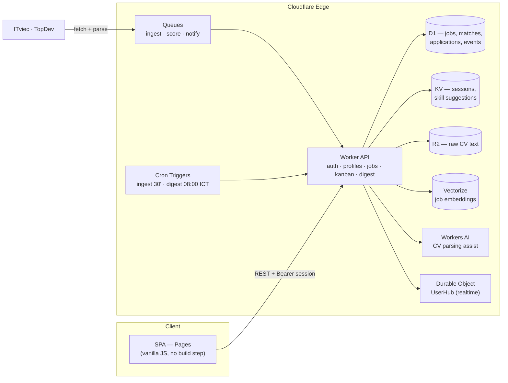

<div align="center">

# JobPilot Edge

**An AI job-hunting copilot for Vietnamese developers — running almost entirely on Cloudflare's free tiers.**

*Săn việc, có hệ thống. · Built for one purpose: turn scattered job boards into a scored, trackable pipeline.*

[](https://jobpilot-edge.pages.dev)
[](https://jobpilot-api.tribui-it-work.workers.dev/api/health)
[](LICENSE)
[](https://www.cloudflare.com/)


</div>

## About

JobPilot Edge continuously scans **ITviec** and **TopDev**, scores every posting against your real profile (skills extracted from your own CV), and tracks applications on a 7-stage kanban board — with a morning digest so the best matches find *you* first.

It is the product-grade successor of a personal job-watcher tool, rebuilt from scratch as an edge-native application: **no servers, no containers** — just Workers, Queues, D1, KV, R2, Vectorize and Workers AI composed into one system.

## Features

- **Multi-profile** — track several job searches (e.g. "Backend — Java", "Backend — Node") with independent skill sets and scores.
- **CV → skills extraction** — upload a PDF; text is extracted in the browser (PDF.js), then Workers AI + a curated skill catalog propose weighted skills for you to confirm.
- **Dual-source ingestion** — ITviec + TopDev fetched every 30 minutes via Queues + cron, deduplicated by content hash, with a title gate that filters out non-tech postings.
- **Transparent scoring** — rule-based and explainable: matched-skill weight over the *job's* required-skill weight, plus location / freshness / level fit. Jobs listing fewer than 3 skills are capped — no more "Senior HR" scoring 90%.
- **Application kanban** — 7 stages (New → Saved → Applied → Interview → Offer / Rejected / Archived) with follow-up dates and an event history.
- **Morning brief** — a daily 08:00 (ICT) digest of strong matches and due follow-ups, rendered as a gradient-edged panel with animated counters.
- **Command palette** — `Cmd/Ctrl + K` to search jobs, jump between views, trigger a scan or switch profiles. Keyboard-first: `1/2/3` switch tabs, `/` focuses search.
- **Realtime-ready** — a Durable Object hub broadcasts strong-match events to connected clients.
- **Modern UI** — Linear-style product shell with Resend-style accents: hairline surfaces, Inter + Space Grotesk, score rings, skeleton loading, staggered reveals.
- **Light / dark themes** — a single toggle (landing nav, auth screen, app sidebar); the whole token system flips, the choice persists and the first visit follows the OS preference.
- **Real accounts** — email + password registration and login (PBKDF2-SHA256, salted, via WebCrypto; brute-force throttling). Accounts created before passwords existed claim one on first sign-in.
- **Landing page** — logged-out visitors get a product landing that explains the scoring formula and the 4-step quickstart *before* the app; new accounts start completely empty with a 3-step onboarding checklist (no seeded demo data).

## Screenshots

| Landing | Morning brief & job scores |
|---|---|
|  |  |

| Kanban pipeline | Command palette (⌘K) |
|---|---|
|  |  |

| Profile & CV skills |
|---|
|  |

## Architecture



| Layer | Service | Role |
|---|---|---|
| Frontend | Pages | Static SPA hosting (Direct Upload deploys) |
| API | Workers | All business logic in a single dependency-free Worker |
| Async | Queues (×3) | Ingest, scoring and notify pipelines with retries |
| Data | D1 (SQLite) | 14 tables: users, profiles, jobs, matches, applications, events… |
| Cache/session | KV | 30-day sessions, CV skill suggestions |
| Files | R2 | Raw CV text storage |
| Semantic | Vectorize (768d) | Job embeddings for future semantic matching |
| AI | Workers AI | Llama 3.1 8B assists CV skill extraction |
| Realtime | Durable Objects | Per-user hub for strong-match broadcasts |

### Scoring model

```
rule_score  = matched_skill_weight / job_required_skill_weight × 50
fit_score   = location (≤8) + freshness (≤7) + level fit (≤5)
final_score = (rule_score + fit_score) / 70 × 100

tiers:  strong ≥ 75 · partial ≥ 50 · weak < 50
guard:  jobs listing < 3 skills are capped at 69 (evidence cap)
```

## Tech stack

- **Runtime:** Cloudflare Workers (V8 isolates), vanilla JavaScript — zero npm dependencies in the API.
- **Frontend:** single-file SPA (`apps/web/public/index.html`), vanilla JS + PDF.js via CDN, Google Fonts (Inter, Space Grotesk).
- **Data:** D1 / SQLite migrations, KV, R2.
- **Design language:** see [`docs/UI-V2-SPEC.md`](docs/UI-V2-SPEC.md) — the Linear × Resend design study behind UI v2.

## Project structure

```
jobpilot-edge/
├── PLAN.md                       # Full product & architecture plan
├── apps/
│   ├── api/
│   │   ├── src/worker.js         # Worker API + queue consumers + cron + DO
│   │   └── wrangler.toml.example # Bindings template (copy → wrangler.toml)
│   └── web/public/index.html     # The entire SPA
├── db/migrations/                # 0001 schema (14 tables) · 0002 password auth
└── docs/
    ├── UI-V2-SPEC.md             # UI v2 design spec
    └── screenshots/              # README screenshots
```

## Getting started

> Deployment is API-driven (resources are provisioned and the Worker is uploaded through the Cloudflare API), so there is no single `wrangler deploy` command to copy. The outline:

1. Create the Cloudflare resources: one KV namespace, three Queues, one D1 database, one R2 bucket, one Vectorize index (768 dimensions, cosine).
2. Apply the schema: run `db/migrations/0001_init.sql` against D1.
3. Copy `apps/api/wrangler.toml.example` → `apps/api/wrangler.toml` and fill in your resource IDs.
4. Deploy `apps/api/src/worker.js` as a Worker with bindings `DB, KV, FILES, EMB, AI`, queues `INGEST_Q / SCORE_Q / NOTIFY_Q`, the `UserHub` Durable Object, and cron triggers `*/30 * * * *` (ingest) + `0 1 * * *` (digest, 08:00 ICT).
5. Deploy `apps/web/public/` to a Pages project. The SPA expects the API at the `API_BASE` constant near the top of its script — point it at your Worker.

Authentication is password-based: passwords are hashed with PBKDF2-SHA256 (100k iterations, per-user salt, WebCrypto) and sessions are Bearer tokens stored in KV with a 30-day TTL. Email verification, magic links and Cloudflare Access for admin routes arrive with the custom-domain phase.

## Roadmap

- [x] **Phase 0** — Edge infrastructure provisioned (10/10 bindings healthy)
- [x] **Phase 1** — MVP: auth, profiles, CV skills, ingestion, scoring, kanban, digest
- [x] **UI v2** — Linear × Resend redesign, command palette
- [x] **Phase 1.5** — Password auth (register / login / first-time claim), landing page, empty-start onboarding
- [ ] **Phase 2** — Semantic matching (Vectorize), AI cover-letter drafts
- [ ] **Phase 3** — Custom domain, email digest (Resend), Cloudflare Access for `/admin`
- [ ] **Phase 4** — Public beta for Vietnamese devs

## License

[MIT](LICENSE) © 2026 Bui Duc Tri

---

<div align="center">
<sub>JobPilot Edge is a personal product experiment by <a href="https://krissbui.vercel.app">Kriss Bui</a> — successor to Job Watcher, designed & built on the Cloudflare free tier.</sub>
</div>
