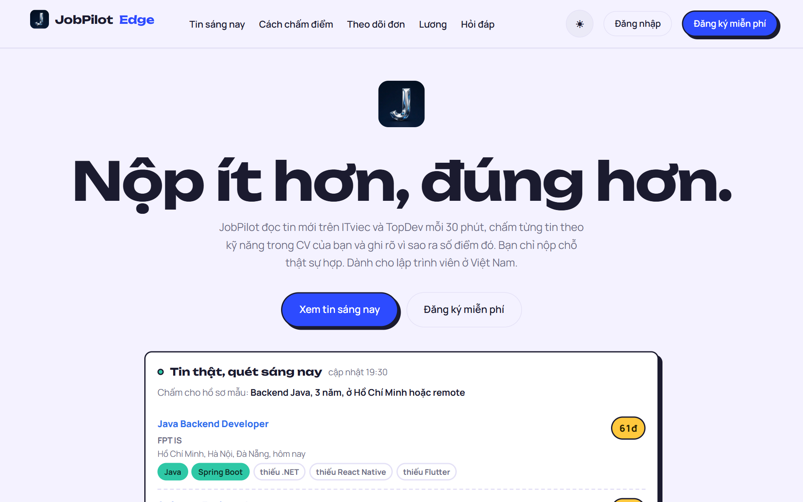
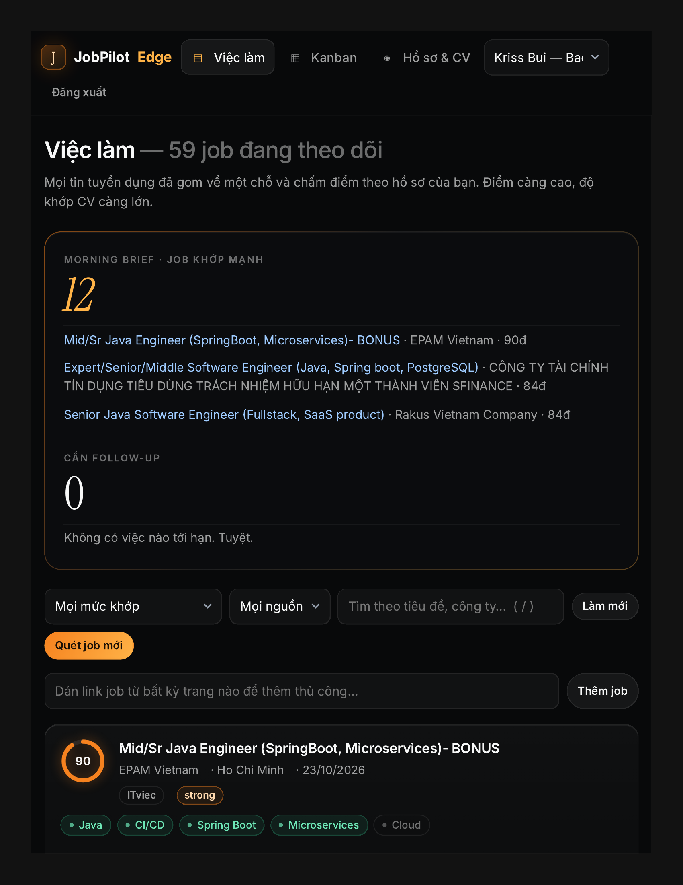
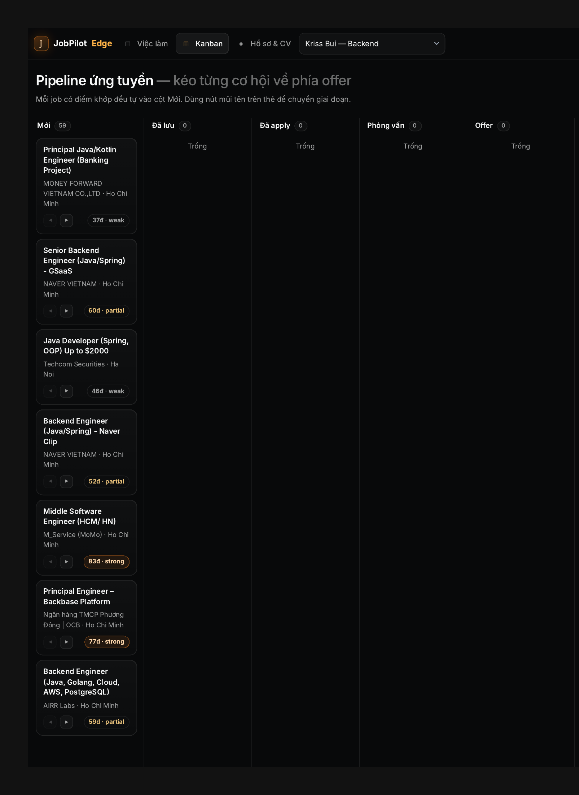
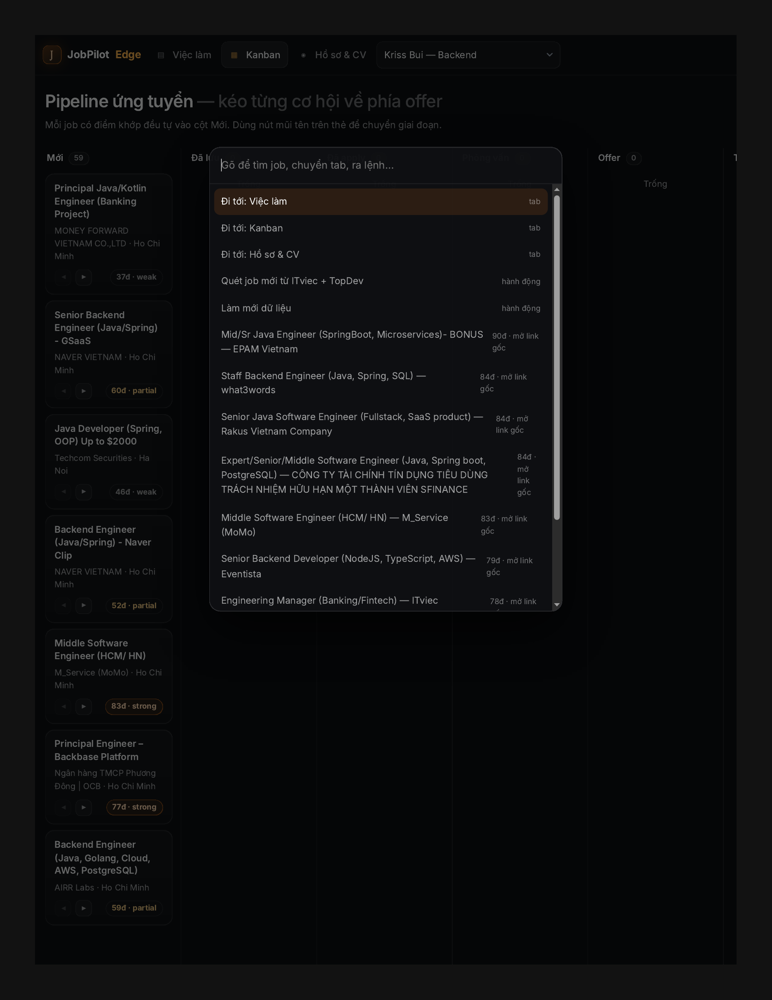
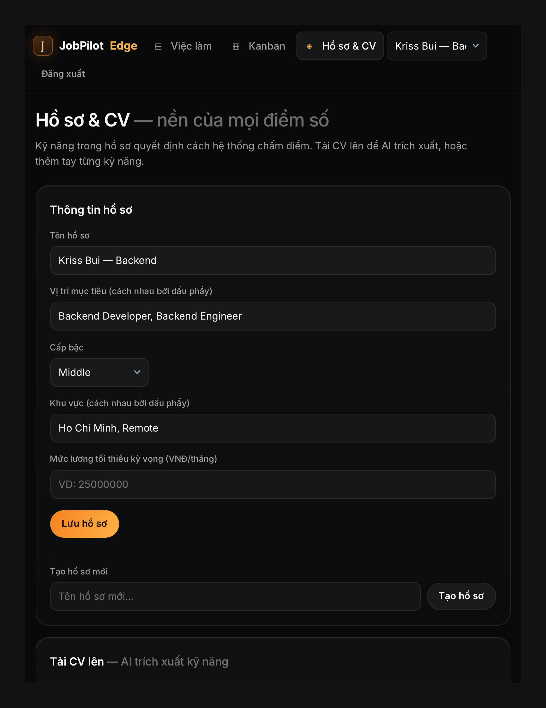
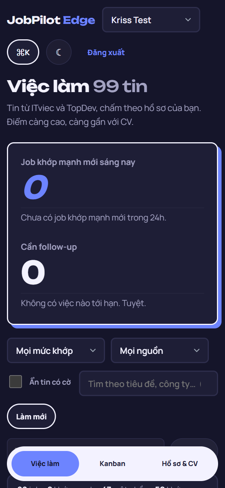
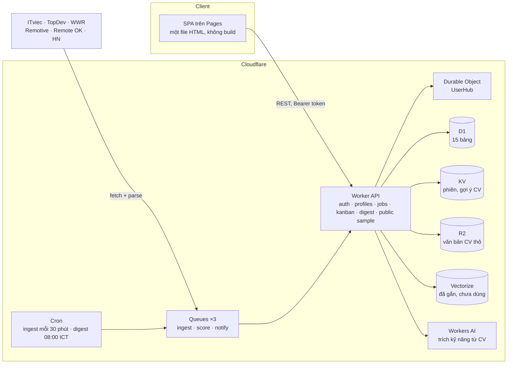

<div align="center">

# JobPilot Edge

**Trợ lý săn việc cho lập trình viên Việt Nam, chạy hoàn toàn trên hạ tầng edge của Cloudflare.**

*Nộp ít hơn, đúng hơn.* Gom tin từ sáu nguồn mỗi 30 phút, chấm từng tin theo kỹ năng trong CV của bạn, giải thích vì sao ra số điểm đó, và theo dõi đơn ứng tuyển trên bảng kanban. Có tiếng Việt và tiếng Anh.

[English](README.md) · **Tiếng Việt**

[](https://jobpilot-edge.pages.dev)
[](https://jobpilot-api.tribui-it-work.workers.dev/api/health)
[](LICENSE)
[](https://developers.cloudflare.com/workers/)



</div>

## Ứng dụng làm gì

1. **Gom tin** mới mỗi 30 phút từ ITviec và TopDev (thị trường Việt Nam) và bốn bảng việc remote công khai: We Work Remotely, Remotive, Remote OK và thread "Who is hiring?" hằng tháng trên Hacker News. Tin trùng bị loại bằng content hash, bộ lọc tiêu đề bỏ các vị trí không phải kỹ thuật.
2. **Chấm điểm** từng tin cho từng hồ sơ của bạn: trọng số kỹ năng khớp trên trọng số kỹ năng tin yêu cầu, cộng độ phù hợp về khu vực, độ mới và cấp bậc. Mỗi thẻ đều hiện bảng phân tích, nên điểm không bao giờ là hộp đen.
3. **Theo dõi đơn** qua 7 giai đoạn (Mới, Đã lưu, Đã apply, Phỏng vấn, Offer, Từ chối, Lưu trữ) với ngày follow-up, cảnh báo im lặng và lịch sử sự kiện.
4. **Tóm tắt buổi sáng** lúc 08:00 giờ Việt Nam: tin khớp mạnh mới và các follow-up đến hạn.

Trang giới thiệu không phải ảnh dựng: nó gọi `GET /api/public/sample` và hiển thị 5 tin ITviec/TopDev khớp nhất cho một hồ sơ backend mẫu lấy từ bảng job thật, kèm giờ quét gần nhất.

## Tình trạng MVP

MVP đã chạy thật và được dùng hằng ngày. Ngày 3/11/2026, production có 330 tin từ sáu nguồn, 9 tài khoản và 10 hồ sơ; mọi nguồn đều báo `ok`.

| | Phạm vi |
|---|---|
| **Đã có** | Tài khoản email + mật khẩu, nhiều hồ sơ, tải CV và gợi ý kỹ năng, điền nháp hồ sơ từ CV, sáu nguồn job, chấm điểm có giải thích và có trần, cờ cảnh báo tin, kanban 7 cột kèm follow-up và cảnh báo im lặng, tóm tắt sáng trong app, benchmark lương, command palette, giao diện sáng/tối, giao diện tiếng Việt và tiếng Anh |
| **Mới có ở backend** | Hub realtime (Durable Object) và `/api/notifications` đã có nhưng web app chưa dùng. Vectorize đã gắn nhưng chưa ghi embedding nào. Tóm tắt sáng được dựng mỗi ngày nhưng chỉ hiện trong app; gửi email cần domain riêng |
| **Lỗ hổng đã biết** | Thêm job bằng link tải được URL bất kỳ và tin hiện cho mọi user (bản sửa ở nhánh `task/T-05`, chưa merge). Chấm điểm chưa có nội dung JD, chỉ dựa trên tag kỹ năng mỗi board công bố, nên nhiều tin remote dừng ở 69. Benchmark lương rơi về bảng tham khảo vì ít tin ghi lương. Tóm tắt sáng chỉ xem được trong app. Turnstile đang chạy test key của Cloudflare cho tới khi cấu hình widget thật |
| **Chưa làm** | Giải thích bằng AI và prep phỏng vấn, khớp ngữ nghĩa, AI Gateway, Browser Rendering cho trang job cần JS, Email Routing, Turnstile, trang hồ sơ công khai, backup D1, quên mật khẩu |

Kế hoạch đầy đủ, chia phase kèm tiêu chí nghiệm thu, nằm ở [`PLAN.md`](PLAN.md).

## Tính năng

| Mảng | Chi tiết |
|---|---|
| Hồ sơ | Nhiều hướng tìm việc trên một tài khoản (ví dụ "Backend Java" và "Backend Node"), mỗi hồ sơ có kỹ năng kèm trọng số, vị trí mục tiêu, cấp bậc, khu vực và lương tối thiểu riêng. Nhân bản được hồ sơ kèm kỹ năng. |
| CV thành hồ sơ | Tải PDF, TXT hoặc MD. Văn bản được trích ngay trên trình duyệt (PDF.js). Workers AI cùng danh mục kỹ năng đề xuất kỹ năng kèm trọng số để bạn xác nhận bằng thanh 1 đến 5. Thẻ "Tạo hồ sơ từ CV" điền sẵn tên, vị trí, cấp bậc và khu vực dạng nháp, chỉ lưu khi bạn bấm Lưu. |
| Nguồn job | ITviec và TopDev lấy theo từ khoá (Java, Node.js, Backend, Spring Boot). We Work Remotely (5 feed RSS), Remotive, Remote OK và HN Who's Hiring lấy một lần mỗi lượt, không cần API key. Tab Việc làm lọc được theo nguồn. |
| Chấm điểm | Điểm quy tắc trên 50 cộng điểm phù hợp trên 20, quy về thang 100. Mỗi tin giải thích kỹ năng khớp và thiếu kèm trọng số, lý do về khu vực, độ mới, cấp bậc. Chấm lại được một tin bằng hồ sơ khác của bạn. |
| Chốt chặn | Tin liệt kê dưới 3 kỹ năng bị chặn trần 69. Tin lệch cấp bậc hoặc ngoài khu vực của bạn bị chặn trần 74, nên không bao giờ hiện là "khớp mạnh". |
| Cờ cảnh báo | Chip tin cũ (quá 30 ngày), tin trùng (cùng công ty và tiêu đề), JD phình (quá 12 kỹ năng), kèm bộ lọc ẩn tin có cờ. |
| Kanban | Kéo thả trên desktop, nút mũi tên trên mobile, hành động follow-up và hoãn, bảng "Cần chú ý" cho đơn im lặng 7 ngày hoặc quá ngày follow-up. |
| Benchmark lương | Trung vị và khoảng P25 đến P75 từ các tin có ghi lương; khi chưa đủ dữ liệu thì dùng bảng tham khảo thị trường có ghi rõ nguồn. Kèm 4 kịch bản đàm phán. |
| Command palette | `Ctrl/Cmd + K` để tìm tin, chuyển tab và hồ sơ, làm mới dữ liệu. Phím `1` `2` `3` chuyển tab, `/` vào ô tìm kiếm. |
| Tài khoản | Email và mật khẩu (PBKDF2-SHA256, 100k vòng, salt riêng từng user, WebCrypto). Sai mật khẩu 5 lần thì tài khoản bị khoá 10 phút, đếm nguyên tử trong D1. Phiên là Bearer token 30 ngày lưu trong KV. |
| Ngôn ngữ | Mặc định tiếng Việt, đổi sang tiếng Anh bằng nút EN/VI hoặc `?lang=en`. Chuỗi do API trả (lý do điểm, cờ, ghi chú benchmark) theo header `Accept-Language`. |
| Giao diện | Sáng và tối, một nút chuyển ở trang giới thiệu, màn đăng nhập và trong app. Lần đầu mở theo cài đặt hệ điều hành. |

## Ảnh màn hình

| Danh sách việc kèm phân tích điểm | Pipeline kanban |
|---|---|
|  |  |

| Command palette | Hồ sơ và kỹ năng |
|---|---|
|  |  |

<details>
<summary>Mobile, giao diện tối</summary>
<p align="center"></p>
</details>

## Kiến trúc



| Tầng | Dịch vụ | Vai trò |
|---|---|---|
| Frontend | Pages | `apps/web/public/index.html`, deploy bằng direct upload |
| API | Workers | Một Worker không phụ thuộc thư viện: 19 HTTP route, queue consumer, cron handler, lớp Durable Object |
| Bất đồng bộ | Queues | Pipeline gom tin, chấm điểm và thông báo, có retry |
| Dữ liệu | D1 | Users, profiles, skills, jobs, matches, applications, events, digests, login failures |
| Phiên và cache | KV | Phiên 30 ngày, gợi ý kỹ năng từ CV giữ 24 giờ |
| Tệp | R2 | Văn bản CV thô |
| Ngữ nghĩa | Vectorize (768 chiều) | Đã gắn để khớp ngữ nghĩa sau này, chưa ghi dữ liệu |
| AI | Workers AI | Llama 3.1 8B hỗ trợ trích kỹ năng từ CV |
| Realtime | Durable Objects | Hub theo user để phát sự kiện khớp mạnh (web app chưa dùng) |

### Mô hình chấm điểm

```
rule_score  = Σ trọng số(kỹ năng khớp) / Σ trọng số(kỹ năng tin yêu cầu) × 50
fit_score   = khu vực (≤ 8) + độ mới (≤ 7) + cấp bậc (≤ 5)
final_score = (rule_score + fit_score) / 70 × 100

mức     khớp mạnh ≥ 75 · một phần ≥ 50 · yếu < 50
trần    dưới 3 kỹ năng → 69 · lệch cấp bậc hoặc ngoài khu vực → 74
```

Tin remote thường ghi dưới ba kỹ năng có trong danh mục, nên nhiều tin dừng ở 69 là đúng thiết kế.

## Cấu trúc thư mục

```
jobpilot-edge/
├── PLAN.md                        # Kế hoạch sản phẩm và kiến trúc
├── apps/
│   ├── api/
│   │   ├── src/worker.js          # Worker: API, fetcher, queue, cron, Durable Object
│   │   ├── test/
│   │   │   ├── score.selfcheck.cjs          # bất biến của công thức điểm
│   │   │   └── remote-sources.selfcheck.cjs # parser WWR / Remotive / Remote OK / HN, chạy offline
│   │   └── wrangler.toml.example  # Mẫu binding
│   └── web/
│       ├── public/index.html      # Toàn bộ SPA (CSS và JS inline)
│       └── test/i18n.selfcheck.cjs
├── db/migrations/
│   ├── 0001_init.sql              # 14 bảng
│   ├── 0002_auth_passwords.sql    # cột mật khẩu
│   └── 0003_login_failures.sql    # bộ đếm chặn đăng nhập sai
└── docs/
    ├── SIGNAL-UI.md               # Token thiết kế và component của giao diện đang chạy
    ├── UI-V2-SPEC.md              # Bản nghiên cứu thiết kế trước, giữ làm lịch sử
    └── screenshots/
```

## Tự chạy

Cần: tài khoản Cloudflare, Node 18+, `wrangler` 4 (`npx wrangler@4`).

```bash
# 1. Binding
cp apps/api/wrangler.toml.example apps/api/wrangler.toml
#    tạo một KV namespace, một D1 database, một R2 bucket, sáu Queue
#    (ingest, score, notify và ba DLQ tương ứng) và một Vectorize index (768 chiều, cosine),
#    rồi dán ID vào wrangler.toml

# 2. Schema (chạy đủ ba file, đúng thứ tự)
cd apps/api
npx wrangler@4 d1 execute <db-name> --remote --file ../../db/migrations/0001_init.sql
npx wrangler@4 d1 execute <db-name> --remote --file ../../db/migrations/0002_auth_passwords.sql
npx wrangler@4 d1 execute <db-name> --remote --file ../../db/migrations/0003_login_failures.sql

# 3. Worker (cron lấy từ wrangler.toml)
npx wrangler@4 deploy

# 4. Frontend: trỏ hằng API_BASE ở đầu script trong index.html về Worker của bạn, rồi
npx wrangler@4 pages deploy ../web/public --project-name <pages-project>
```

Các nguồn job tự đăng ký ở lượt cron đầu tiên. Chạy local: `npx wrangler@4 dev --local --test-scheduled` trong `apps/api`, và bất kỳ static server nào cho `apps/web/public` với `API_BASE` đổi thành `http://127.0.0.1:8787`. Gọi `/__scheduled?cron=*/30+*+*+*+*` để kích một lượt gom tin.

Thứ tự deploy khi có thay đổi schema: migration, rồi Worker, rồi Pages.

### Kiểm tra chất lượng

```bash
node apps/api/test/score.selfcheck.cjs apps/api/src/worker.js
node apps/api/test/remote-sources.selfcheck.cjs apps/api/src/worker.js
node apps/api/test/wrangler-config.selfcheck.cjs apps/api/src/worker.js apps/api/wrangler.toml.example
node apps/api/test/d1-budget.selfcheck.cjs apps/api/src/worker.js apps/api/wrangler.toml.example
node apps/web/test/i18n.selfcheck.cjs apps/web/public/index.html
```

Trong các đợt phát hành tháng 10, giao diện còn được kiểm bằng ma trận Playwright (3 tab, 5 bề rộng từ 360 đến 1424 px, sáng và tối) và [impeccable](https://github.com/pbakaus/impeccable) trên trang giới thiệu production. Các script đó không nằm trong repo này.

## Tổng quan API

Mọi route nằm dưới `/api`. Route cần đăng nhập nhận `Authorization: Bearer <token>`. Gửi `Accept-Language: en` để nhận chuỗi tiếng Anh.

| Route | Mục đích |
|---|---|
| `GET /health` | Trạng thái binding |
| `GET /public/sample` | Tin ITviec/TopDev khớp nhất cho hồ sơ mẫu, công khai, cache 5 phút |
| `POST /auth/register`, `POST /auth/login` | Tài khoản và phiên |
| `GET /me` | User hiện tại, có `is_owner` |
| `GET` `POST /profiles`, `PATCH /profiles/:id`, `POST /profiles/:id/cv-text`, `POST /profiles/:id/skills/confirm` | Hồ sơ và kỹ năng |
| `GET /jobs`, `GET /jobs/:id`, `POST /jobs/submit` | Tin đã chấm cho một hồ sơ (lọc theo `source`), thêm tin bằng URL |
| `GET` `POST /applications`, `PATCH /applications/:id` | Kanban |
| `GET /digest/today`, `GET /benchmark`, `GET /notifications` | Tóm tắt sáng, benchmark lương, cảnh báo |
| `GET /realtime` | WebSocket tới Durable Object hub của user |
| `/admin/*` | Chỉ chủ hệ thống: chạy và xem trạng thái gom tin, quota |

## Tình trạng

- **Đang chạy:** production hoạt động từ tháng 10/2026 trên gói Workers Free. Thay đổi gần nhất: giao diện và chuỗi API tiếng Anh (30/10), bốn nguồn job remote (30/10), hiệu ứng hero landing và dọn trạng thái nháp CV (31/10).
- **Bảo mật:** bản vá tháng 10/2026 gỡ luồng nhận mật khẩu cũ (`/api/auth/set-password` trả 410), giới hạn hồ sơ và đơn theo chủ sở hữu, và chỉ cho tài khoản chủ hệ thống gọi route admin. Các mục còn mở nằm ở bảng Lỗ hổng đã biết phía trên.
- **3/11/2026:** không còn tự sinh thẻ kanban (migration 0004 xoá 1.386 thẻ), từ khoá quét theo hồ sơ thật, tin remote khoá vùng không còn tính khớp khu vực; đăng xuất thu hồi phiên, CV tối đa 5 MB, giới hạn đăng ký theo IP, đồng ý trước khi tải CV, xoá tài khoản có 7 ngày khôi phục, xuất dữ liệu, backup D1 → R2 hằng ngày, Turnstile (test key).
- **Tiếp theo:** merge bản sửa thêm job bằng link, lấy JD cho tin từ mức "một phần" trở lên, hiện lịch sử đăng lại và số ngày treo của từng tin, bản tin Telegram hằng ngày, dead-letter queue, quên mật khẩu. Xem [`ROADMAP.md`](ROADMAP.md).

## Giấy phép

[MIT](LICENSE) © 2026 Bùi Đức Trí

---

<div align="center">
<sub>Do <a href="https://krissbui.vercel.app">Kriss Bui</a> xây dựng, kế thừa Job Watcher. Ưu tiên tiếng Việt, chỉ chạy trên edge, không có server nào phải trông coi.</sub>
</div>
