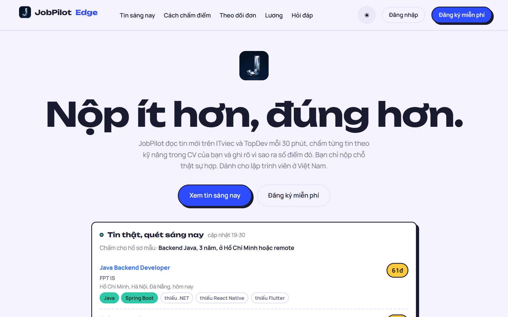
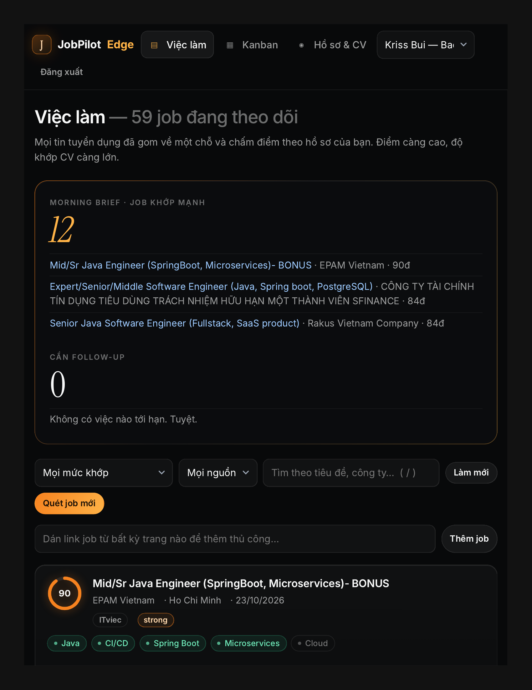
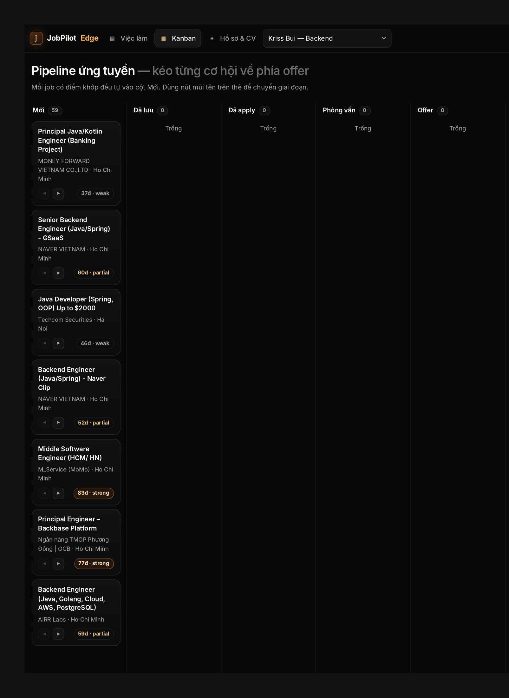
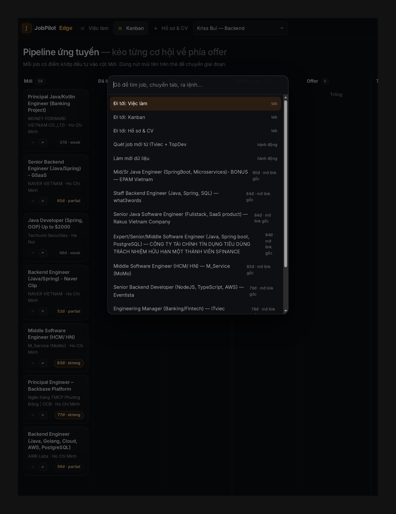
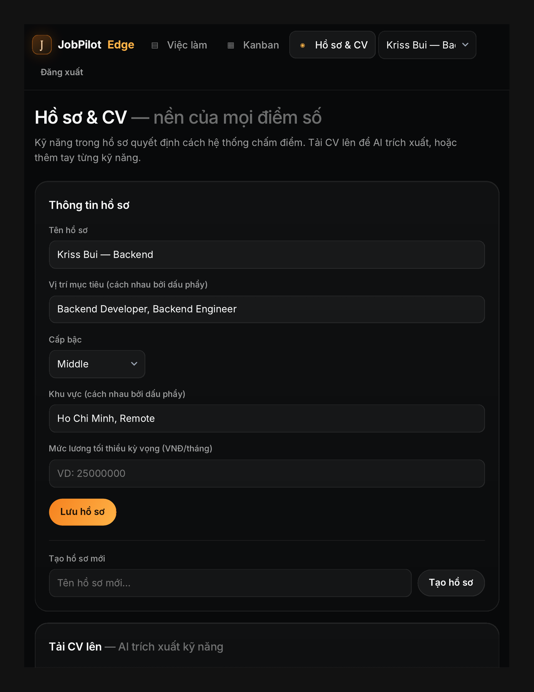
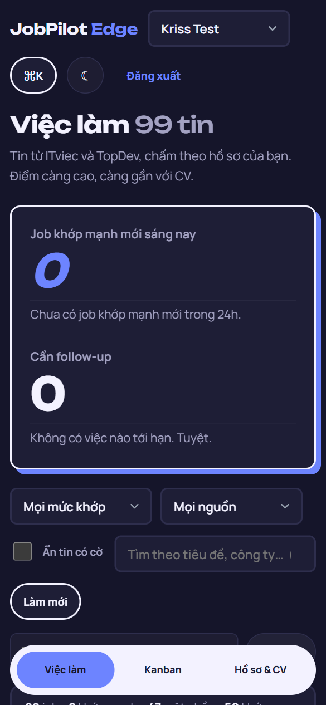
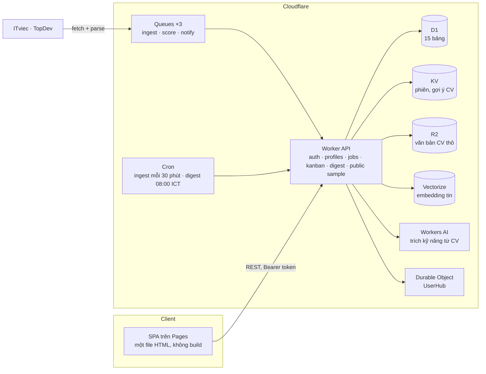

<div align="center">

# JobPilot Edge

**Trợ lý săn việc cho lập trình viên Việt Nam, chạy hoàn toàn trên hạ tầng edge của Cloudflare.**

*Nộp ít hơn, đúng hơn.* Quét ITviec và TopDev mỗi 30 phút, chấm từng tin theo kỹ năng trong CV của bạn, giải thích vì sao ra số điểm đó, và theo dõi đơn ứng tuyển trên bảng kanban.

[English](README.md) · **Tiếng Việt**

[](https://jobpilot-edge.pages.dev)
[](https://jobpilot-api.tribui-it-work.workers.dev/api/health)
[](LICENSE)
[](https://developers.cloudflare.com/workers/)



</div>

## Ứng dụng làm gì

1. **Gom tin** mới từ ITviec và TopDev theo cron (30 phút một lần), loại trùng bằng content hash, có bộ lọc tiêu đề để bỏ các vị trí không phải kỹ thuật.
2. **Chấm điểm** từng tin cho từng hồ sơ của bạn: trọng số kỹ năng khớp trên trọng số kỹ năng tin yêu cầu, cộng độ phù hợp về khu vực, độ mới và cấp bậc. Mỗi thẻ đều hiện bảng phân tích, nên điểm không bao giờ là hộp đen.
3. **Theo dõi đơn** qua 7 giai đoạn (Mới, Đã lưu, Đã apply, Phỏng vấn, Offer, Từ chối, Lưu trữ) với ngày follow-up, cảnh báo im lặng và lịch sử sự kiện.
4. **Tóm tắt buổi sáng** lúc 08:00 giờ Việt Nam: tin khớp mạnh mới và các follow-up đến hạn.

Trang giới thiệu không phải ảnh dựng: nó gọi `GET /api/public/sample` và hiển thị 5 tin khớp nhất cho một hồ sơ backend mẫu lấy từ bảng job thật, kèm giờ quét gần nhất.

## Tính năng

| Mảng | Chi tiết |
|---|---|
| Hồ sơ | Nhiều hướng tìm việc trên một tài khoản (ví dụ "Backend Java" và "Backend Node"), mỗi hồ sơ có kỹ năng kèm trọng số, vị trí mục tiêu, cấp bậc, khu vực và lương tối thiểu riêng. |
| CV thành kỹ năng | Tải PDF, TXT hoặc MD. Văn bản được trích ngay trên trình duyệt (PDF.js), rồi Workers AI cùng danh mục kỹ năng chuẩn đề xuất kỹ năng kèm trọng số để bạn xác nhận bằng thanh 1 đến 5. |
| Chấm điểm | Điểm quy tắc trên 50 cộng điểm phù hợp trên 20, quy về thang 100. Giải thích được cho từng tin: kỹ năng khớp và thiếu kèm trọng số, lý do về khu vực, độ mới, cấp bậc. |
| Chốt chặn | Tin liệt kê dưới 3 kỹ năng bị chặn trần 69. Tin lệch cấp bậc hoặc ngoài khu vực của bạn bị chặn trần 74, nên không bao giờ hiện là "khớp mạnh". |
| Cờ cảnh báo | Chip tin cũ (quá 30 ngày), tin trùng (cùng công ty và tiêu đề), JD phình (quá 12 kỹ năng), kèm bộ lọc ẩn tin có cờ. |
| Kanban | Kéo thả trên desktop, nút mũi tên trên mobile, hành động follow-up và hoãn, bảng "Cần chú ý" cho đơn im lặng 7 ngày hoặc quá ngày follow-up. |
| Benchmark lương | Trung vị và khoảng P25 đến P75 từ các tin có ghi lương; khi chưa đủ dữ liệu thì dùng bảng tham khảo thị trường có ghi rõ nguồn. Kèm 4 kịch bản đàm phán. |
| Command palette | `Ctrl/Cmd + K` để tìm tin, chuyển tab và hồ sơ, làm mới dữ liệu. Phím `1` `2` `3` chuyển tab, `/` vào ô tìm kiếm. |
| Tài khoản | Email và mật khẩu (PBKDF2-SHA256, 100k vòng, salt riêng từng user, WebCrypto). Sai mật khẩu 5 lần trên một tài khoản sẽ bị chặn tạm bằng bộ đếm trong D1. Phiên là Bearer token 30 ngày lưu trong KV. |
| Giao diện | Sáng và tối, một nút chuyển ở trang giới thiệu, màn đăng nhập và trong app. Lần đầu mở theo cài đặt hệ điều hành. |
| Realtime | Mỗi user có một Durable Object hub phát sự kiện khớp mạnh tới các client đang kết nối. |

## Ảnh màn hình

| Danh sách việc kèm phân tích điểm | Pipeline kanban |
|---|---|
|  |  |

| Command palette | Hồ sơ và kỹ năng |
|---|---|
|  |  |

<details>
<summary>Mobile, giao diện tối</summary>
<p align="center"></p>
</details>

## Kiến trúc



| Tầng | Dịch vụ | Vai trò |
|---|---|---|
| Frontend | Pages | `apps/web/public/index.html`, deploy bằng direct upload |
| API | Workers | Một Worker không phụ thuộc thư viện: HTTP route, queue consumer, cron handler, lớp Durable Object |
| Bất đồng bộ | Queues | Pipeline gom tin, chấm điểm và thông báo, có retry |
| Dữ liệu | D1 | Users, profiles, skills, jobs, matches, applications, events, digests, login failures |
| Phiên và cache | KV | Phiên 30 ngày, gợi ý kỹ năng từ CV giữ 24 giờ |
| Tệp | R2 | Văn bản CV thô |
| Ngữ nghĩa | Vectorize (768 chiều) | Embedding tin, dành cho khớp ngữ nghĩa sau này |
| AI | Workers AI | Llama 3.1 8B hỗ trợ trích kỹ năng từ CV |
| Realtime | Durable Objects | Hub theo user để phát sự kiện khớp mạnh |

### Mô hình chấm điểm

```
rule_score  = Σ trọng số(kỹ năng khớp) / Σ trọng số(kỹ năng tin yêu cầu) × 50
fit_score   = khu vực (≤ 8) + độ mới (≤ 7) + cấp bậc (≤ 5)
final_score = (rule_score + fit_score) / 70 × 100

mức     khớp mạnh ≥ 75 · một phần ≥ 50 · yếu < 50
trần    dưới 3 kỹ năng → 69 · lệch cấp bậc hoặc ngoài khu vực → 74
```

Bộ tự kiểm chạy thẳng `fitBreakdown` và `scoreJob` từ mã nguồn Worker nằm ở `apps/api/test/score.selfcheck.cjs`.

## Cấu trúc thư mục

```
jobpilot-edge/
├── PLAN.md                        # Kế hoạch sản phẩm và kiến trúc
├── apps/
│   ├── api/
│   │   ├── src/worker.js          # Worker: API, queue, cron, Durable Object
│   │   ├── test/score.selfcheck.cjs
│   │   └── wrangler.toml.example  # Mẫu binding
│   └── web/public/
│       ├── index.html             # Toàn bộ SPA (CSS và JS inline)
│       └── assets/
├── db/migrations/
│   ├── 0001_init.sql              # 14 bảng
│   ├── 0002_auth_passwords.sql    # cột mật khẩu
│   └── 0003_login_failures.sql    # bộ đếm chặn đăng nhập sai
└── docs/
    ├── SIGNAL-UI.md               # Token thiết kế và component của giao diện đang chạy
    ├── UI-V2-SPEC.md              # Bản nghiên cứu thiết kế trước, giữ làm lịch sử
    └── screenshots/
```

## Tự chạy

Cần: tài khoản Cloudflare, Node 18+, `wrangler` 4 (`npx wrangler@4`).

```bash
# 1. Binding
cp apps/api/wrangler.toml.example apps/api/wrangler.toml
#    tạo một KV namespace, một D1 database, một R2 bucket, ba Queue
#    (ingest, score, notify) và một Vectorize index (768 chiều, cosine),
#    rồi dán ID vào wrangler.toml

# 2. Schema (chạy đủ ba file, đúng thứ tự)
cd apps/api
npx wrangler@4 d1 execute <db-name> --remote --file ../../db/migrations/0001_init.sql
npx wrangler@4 d1 execute <db-name> --remote --file ../../db/migrations/0002_auth_passwords.sql
npx wrangler@4 d1 execute <db-name> --remote --file ../../db/migrations/0003_login_failures.sql

# 3. Worker (cron lấy từ wrangler.toml)
npx wrangler@4 deploy

# 4. Frontend: trỏ hằng API_BASE ở đầu script trong index.html về Worker của bạn, rồi
npx wrangler@4 pages deploy ../web/public --project-name <pages-project>
```

Chạy local: `npx wrangler@4 dev --local --test-scheduled` trong `apps/api`, và bất kỳ static server nào cho `apps/web/public` với `API_BASE` đổi thành `http://127.0.0.1:8787`. Gọi `/__scheduled?cron=*/30+*+*+*+*` để kích một lượt gom tin.

Thứ tự deploy khi có thay đổi schema: migration, rồi Worker, rồi Pages.

### Kiểm tra chất lượng

```bash
node apps/api/test/score.selfcheck.cjs apps/api/src/worker.js   # bất biến của công thức điểm
```

Giao diện được kiểm trước mỗi lần phát hành bằng ma trận Playwright (3 tab × 5 bề rộng từ 360 đến 1424 px × sáng và tối), báo lỗi khi tràn ngang, chữ bị cắt hoặc có lỗi console; và bằng [impeccable](https://github.com/pbakaus/impeccable) trên trang giới thiệu production (0 lỗi chính tính đến 30/10/2026).

## Tổng quan API

Mọi route nằm dưới `/api`. Route cần đăng nhập nhận `Authorization: Bearer <token>`.

| Route | Mục đích |
|---|---|
| `GET /health` | Trạng thái binding |
| `GET /public/sample` | Tin khớp nhất cho hồ sơ mẫu, công khai, cache 5 phút |
| `POST /auth/register`, `POST /auth/login` | Tài khoản và phiên |
| `GET /me` | User hiện tại, có `is_owner` |
| `GET` `POST /profiles`, `PATCH /profiles/:id`, `POST /profiles/:id/cv-text`, `POST /profiles/:id/skills/confirm` | Hồ sơ và kỹ năng |
| `GET /jobs`, `GET /jobs/:id`, `POST /jobs/submit` | Tin đã chấm cho một hồ sơ, thêm tin bằng URL |
| `GET` `POST /applications`, `PATCH /applications/:id` | Kanban |
| `GET /digest/today`, `GET /benchmark`, `GET /notifications` | Tóm tắt sáng, benchmark lương, cảnh báo |
| `GET /realtime` | WebSocket tới Durable Object hub của user |
| `/admin/*` | Chỉ chủ hệ thống: chạy và xem trạng thái gom tin, quota |

## Tình trạng

- **Đang chạy:** production hoạt động từ tháng 10/2026 trên gói Workers Free. Bản mới nhất (30/10/2026) làm lại trang giới thiệu quanh dữ liệu thật, siết trần điểm, và dựng lại bố cục tab Hồ sơ (gợi ý kỹ năng, benchmark, form) sau một lượt rà layout trên mobile và desktop.
- **Bảo mật:** bản vá tháng 10/2026 gỡ luồng nhận mật khẩu cũ (`/api/auth/set-password` trả 410), giới hạn hồ sơ và đơn theo chủ sở hữu, và chỉ cho tài khoản chủ hệ thống gọi route admin.
- **Tiếp theo:** thêm tin thủ công tách theo từng user, Turnstile khi đăng ký, dead-letter queue, đặt lại mật khẩu, domain riêng kèm gửi tóm tắt qua email, Cloudflare Access cho `/admin`.

## Giấy phép

[MIT](LICENSE) © 2026 Bùi Đức Trí

---

<div align="center">
<sub>Do <a href="https://krissbui.vercel.app">Kriss Bui</a> xây dựng, kế thừa Job Watcher. Ưu tiên tiếng Việt, chỉ chạy trên edge, không có server nào phải trông coi.</sub>
</div>
